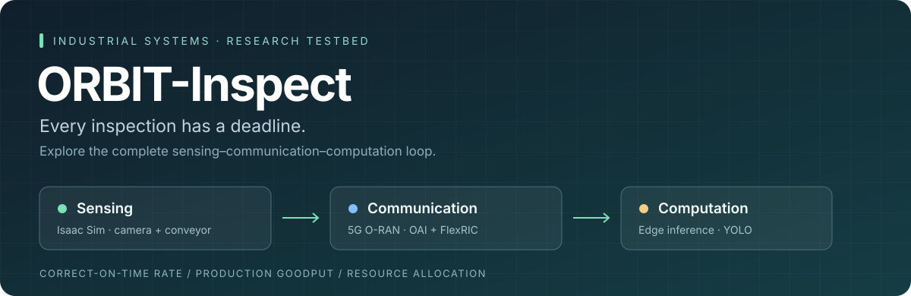
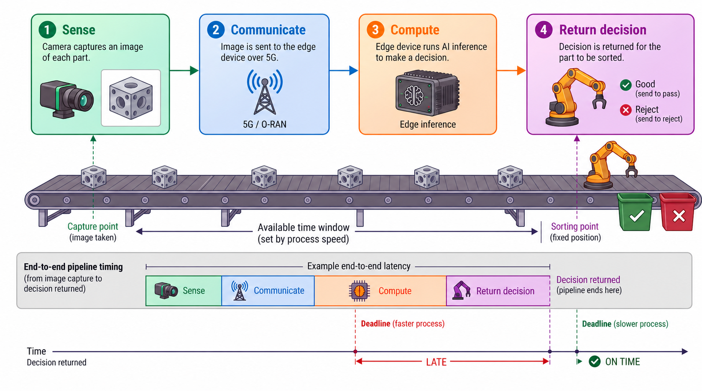
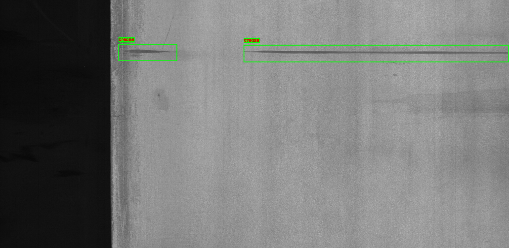
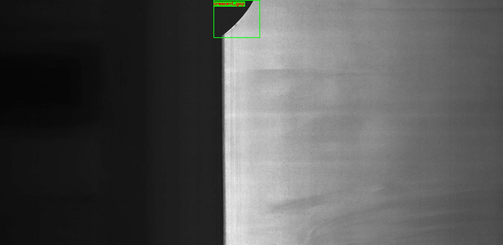
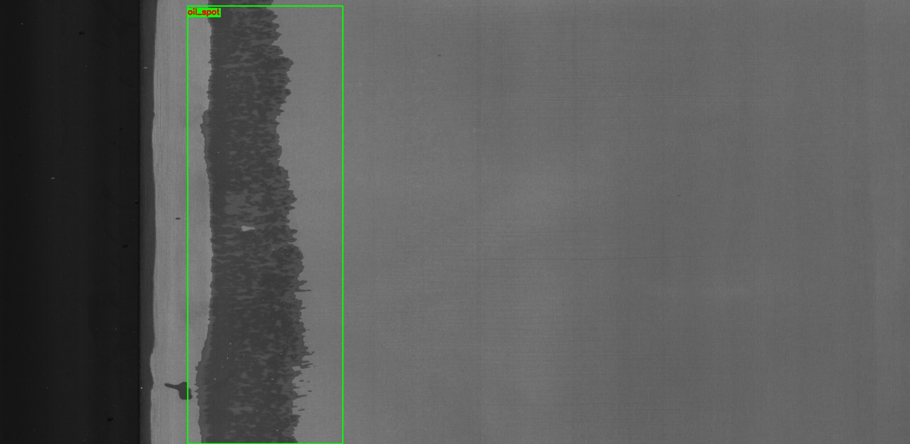
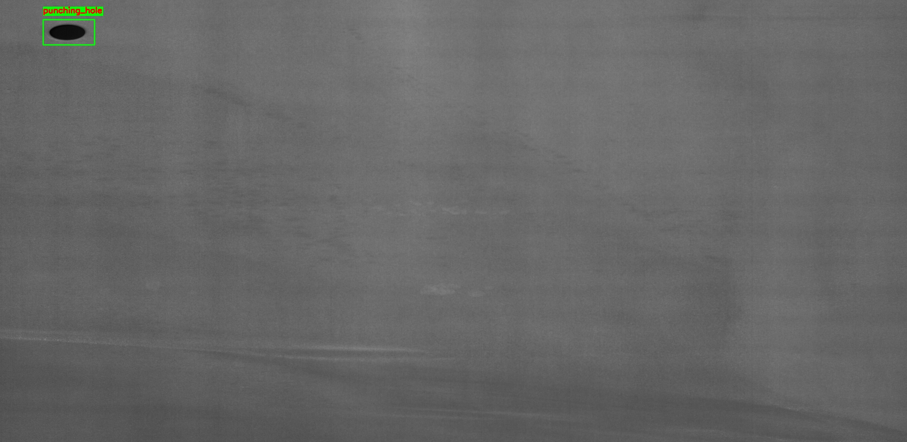
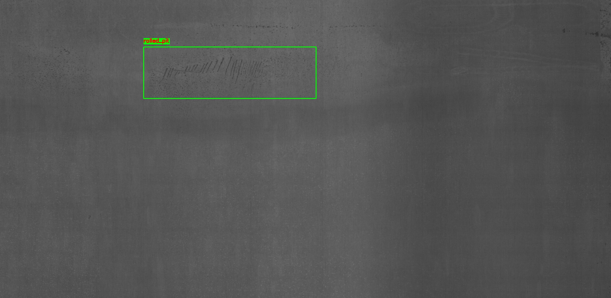
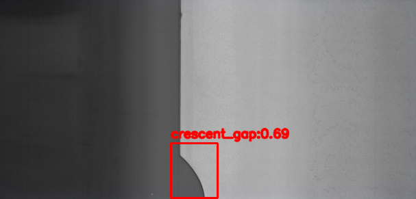
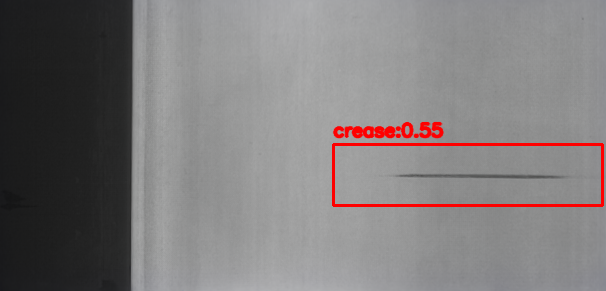

<p align="center">
  
</p>

<p align="center">
  <strong>An interactive research testbed for process-aware industrial inspection.</strong><br>
  Explore how sensing, wireless resources, and edge computing affect correct, on-time decisions.
</p>

<p align="center">
  <a href="https://youtu.be/S_SA_UToFLU">Watch the demo</a> ·
  <a href="https://arxiv.org/abs/2608.13372">Read the paper</a> ·
  <a href="#try-the-dashboard">Try the dashboard</a> ·
  <a href="orbit_inspect_testbed/SETUP_0_TO_100.md">Full setup</a>
</p>

## Why ORBIT-Inspect?

A correct inspection result only helps if it arrives before the part reaches the
sorting point. Increasing conveyor speed shortens that window; increasing camera
resolution changes both the wireless payload and the inference workload.
ORBIT-Inspect makes these dependencies visible through an Isaac Sim digital twin,
programmable 5G O-RAN, and edge visual inference.

| Explore | Observe |
| --- | --- |
| Conveyor speed and camera resolution | Changes in process deadlines and sensing workloads |
| Uplink physical resource block (PRB) allocation and edge CPU quota | Effects of communication and compute resources on the inspection loop |
| Nominal, Stress, and Scarce scenarios | Correct-on-time rate, production goodput, and latency |
| Controller recommendations and adaptation replay | Operating points selected from the measured design space |

## How the inspection loop works



Conveyor speed determines the time available for inspection. Sensing,
communication, and edge inference must deliver a correct decision before the part
reaches the sorting point. The example holds end-to-end latency constant to
illustrate how a faster process can turn an on-time decision into a late one;
actual latency varies with the operating configuration. Timing ends at decision
return, before physical sorting is completed.

## Dataset: GC10-DET

ORBIT-Inspect uses **GC10-DET** metallic surface defect imagery for its inspection
task. The dataset was introduced in
[*Deep Metallic Surface Defect Detection: The New Benchmark and Detection Network*](https://doi.org/10.3390/s20061562).
Credit for the source dataset belongs to its original authors.

[Dataset repository and download instructions](https://github.com/lvxiaoming2019/GC10-DET-Metallic-Surface-Defect-Datasets) ·
[Dataset paper](https://doi.org/10.3390/s20061562)

The Isaac runtime uses the following ten class names: `punching_hole`,
`welding_line`, `crescent_gap`, `water_spot`, `oil_spot`, `silk_spot`, `inclusion`,
`rolled_pit`, `crease`, and `waist_folding`.

GC10-DET source images and images captured from the Isaac Sim scene represent
different stages of the inspection workflow. Dataset examples illustrate defect
appearance; application performance is measured through the complete inspection
loop described in our paper.

### Example defect images

Selected GC10-DET examples with ground-truth bounding-box annotations. Click
an image to inspect it at full resolution. These examples illustrate the visual
task and do not establish detection accuracy.

| Crease | Crescent gap |
| --- | --- |
| [](docs/assets/gc10-det/crease_1.jpg) | [](docs/assets/gc10-det/crescent_gap_1.jpg) |
| **Inclusion** | **Oil spot** |
| [](docs/assets/gc10-det/inclusion_1.jpg) | [](docs/assets/gc10-det/oil_spot_2.jpg) |
| **Punching hole** | **Rolled pit** |
| [](docs/assets/gc10-det/punching_hole_1.jpg) | [](docs/assets/gc10-det/rolled_pit_1.jpg) |

Source imagery: [GC10-DET](https://github.com/lvxiaoming2019/GC10-DET-Metallic-Surface-Defect-Datasets).
Please cite the [original dataset paper](https://doi.org/10.3390/s20061562) when
using GC10-DET in research. See the [sample provenance note](docs/assets/gc10-det/README.md).

### YOLO detection examples

Example detector outputs from the inspection pipeline. **Red boxes** show YOLO
predictions; each label contains the predicted defect class and its confidence
score. **Green boxes** in the dataset gallery above show ground-truth annotations.

| Crescent gap · confidence 0.71 | Crescent gap · confidence 0.69 |
| --- | --- |
| [](docs/assets/yolo-detections/crescent-gap-071.png) | [](docs/assets/yolo-detections/crescent-gap-069.png) |
| **Oil spot · confidence 0.43** | **Crease · confidence 0.55** |
| [](docs/assets/yolo-detections/oil-spot-043.png) | [](docs/assets/yolo-detections/crease-055.png) |

Confidence scores describe individual predictions; they are not measured accuracy
or evidence that a decision met its deadline. These selected examples illustrate
detector behavior. See the paper for the evaluation of the complete inspection
loop and the [image provenance note](docs/assets/yolo-detections/README.md) for source details.

## Try the dashboard

**Measured replay** is the quickest way to explore the interface. It uses the
bundled experiment summary and requires Python 3 and a browser.

From the repository root:

```bash
python3 -m http.server 8765 --bind 127.0.0.1
```

Open **[the replay dashboard](http://127.0.0.1:8765/orbit_inspect_testbed/index.html)**.
Select **Nominal**, **Stress**, or **Scarce**, explore the feasibility map, then
click **Play** under Adaptation Replay.

The controller mode should read **Measured replay**. If it reads **Fallback**, the
measured CSV failed to load and the displayed values come from a fallback model;
do not present those values as experimental results. Live-control functions require
the backend and configured external testbed.

| Mode | Behavior | Requirements |
| --- | --- | --- |
| Measured replay | Explores bundled measured configurations without actuating the testbed | Python 3, browser |
| Live testbed | Applies settings to the running stack and records a new inspection run | Isaac Sim, ROS 2 Jazzy, OAI, FlexRIC, Docker, configured relays |

## Run the live testbed

These commands assume the external stack is installed and configured. For
installation and machine-specific configuration, follow the
[complete setup guide](orbit_inspect_testbed/SETUP_0_TO_100.md).

In a terminal at the repository root:

```bash
source /opt/ros/jazzy/setup.bash
sudo -v
ORBIT3C_RECOVER_CORE=1 ./orbit_inspect_testbed/reset_measured_channel_stack.sh
./orbit_inspect_testbed/start_live_application_stack.sh
./orbit_inspect_testbed/start_live_backend.sh
```

In Isaac Sim, run
[`distance_based_spawning_orbit_inspect_live.py`](orbit_inspect_testbed/runtime_scripts/distance_based_spawning_orbit_inspect_live.py).
Then verify the stack in a second terminal:

```bash
source /opt/ros/jazzy/setup.bash
./orbit_inspect_testbed/check_live_stack.sh
```

Open **[the live dashboard](http://127.0.0.1:8766/orbit_inspect_testbed/index.html)**.
See the [operator guide](orbit_inspect_testbed/README.md) for run acknowledgments,
measurement fields, and recovery instructions.

## Repository map

| Path | Purpose |
| --- | --- |
| [`orbit_inspect_testbed/`](orbit_inspect_testbed/) | Dashboard, backend, launchers, preflight checks, and runtime scripts |
| [`orbit_inspect_testbed/SETUP_0_TO_100.md`](orbit_inspect_testbed/SETUP_0_TO_100.md) | External dependencies and full testbed setup |
| [`automated_experiments/`](automated_experiments/) | Recovery helper and measured replay summary |
| [`edge_relay_oai_dev.py`](edge_relay_oai_dev.py) | Edge-side YOLO TCP service |
| [`ue_forwarder_oai_dev.py`](ue_forwarder_oai_dev.py) | UE tunnel forwarder |
| [`best_n.pt`](best_n.pt) | Model weights used by the demo |
| [`isaac_sim.usd`](isaac_sim.usd) | Bundled Isaac scene asset |

## Measurements and reproducibility

Replay reads
[`summary_current_grid.csv`](automated_experiments/plots_grid_1056_analysis_cleaned/summary_current_grid.csv).
The bundled summary currently contains **960 configuration rows**. The directory
name is retained from the experiment workflow; it is not the row count.

Live runs can use settings outside this measured grid. Treat their outputs as new
measurements rather than interchangeable reproductions of the paper results.
The dashboard reports correct-on-time rate, production goodput, p95 roundtrip
latency, and resource cost.

Generated live CSV and log files are ignored by Git and written under
`orbit_inspect_testbed/live_results/latest/`. After **Apply Live**, the dashboard's
**Result CSV** field identifies the output. Typical files include:

```text
factory_latency_YYYYMMDD_HHMMSS_live_RUNID.csv
factory_latency.csv
```

## Demo video

<p align="center">
  <a href="https://youtu.be/S_SA_UToFLU">
    
  </a>
</p>

<p align="center"><a href="https://youtu.be/S_SA_UToFLU"><strong>▶ Watch the ORBIT-Inspect demo</strong></a></p>

## Research paper

**Process-Aware Cross-Layer Adaptation for O-RAN-Enabled Industrial Systems**

Elahe Delavari, Junaid Farooq, M. Majid Butt, and Quanyan Zhu.

The paper presents PACE, a framework for coordinating sensing, radio, and edge
computing around physical process deadlines, evaluated through a factory-inspection
case study.

[Read on arXiv](https://arxiv.org/abs/2608.13372) ·
[Download PDF](https://arxiv.org/pdf/2608.13372)

<details>
<summary>Cite this work (BibTeX)</summary>

```bibtex
@misc{delavari2026processaware,
  title         = {Process-Aware Cross-Layer Adaptation for O-RAN-Enabled Industrial Systems},
  author        = {Elahe Delavari and Junaid Farooq and M. Majid Butt and Quanyan Zhu},
  year          = {2026},
  eprint        = {2608.13372},
  archivePrefix = {arXiv},
  primaryClass  = {eess.SY},
  url           = {https://arxiv.org/abs/2608.13372}
}
```

</details>
